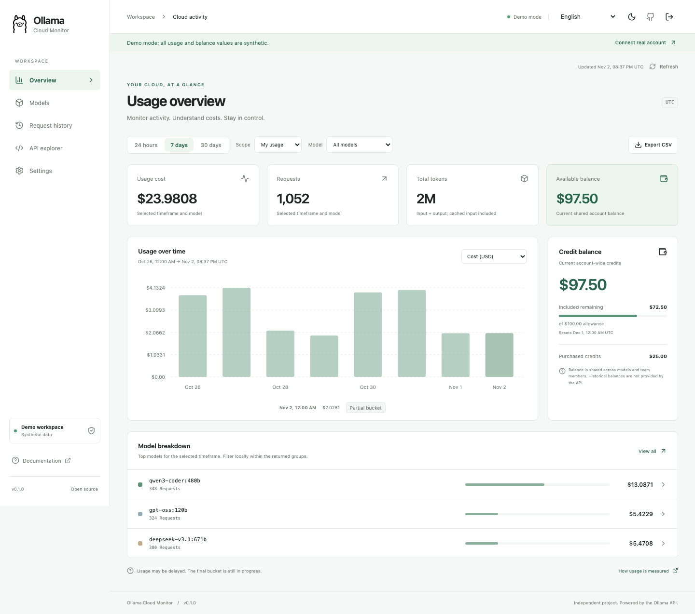

<p align="center"></p>

# Ollama Cloud Monitor

A private, read-only dashboard for Ollama Cloud usage and credit balances. Connect an Ollama API key, choose a timeframe, and explore usage by model. Version **v0.1.0**, initial alpha release.



## Features

- Bearer-token login with credentials held only in memory. No database or account registration.
- 24-hour, 7-day and 30-day usage plots with cost, requests, input, cached input and output tokens.
- Self/team scope, model selection, model comparison and selected-series CSV export.
- Current included + purchased credit balance, monthly allowance and reset times; legacy plan limit support.
- Monitor request history for the current browser session, JSON inspectors and an OpenAPI-driven API explorer.
- Light/dark themes, responsive layouts, English, Spanish, Japanese, Arabic and layout-testing pseudo-locales.
- A clearly marked synthetic demo. It works without an API key.

The upstream [usage API](https://docs.ollama.com/api/cloud-usage) permits only `24h`, `7d`, and `30d`. It returns at most ten named models plus an “other models” remainder. Model filtering operates locally within that response. Custom dates and individual inference request history are unavailable.

The [balance API](https://docs.ollama.com/api/balance) provides a **current shared account balance**. Historical balances and balances per model are unavailable. The dashboard keeps balance account-wide when usage is filtered by model. Legacy cost/token fields that are absent appear as unavailable. Credits and usage can update at different times.

## Run locally

Install **Node.js 24** and the **.NET 10 SDK**. From the repository root:

```sh
git clone https://github.com/jchristn/OllamaCloudMonitor.git
cd OllamaCloudMonitor
npm ci --prefix dashboard
npm run build --prefix dashboard
dotnet run --project src/OllamaCloudMonitor.Server -c Release
```

Open **http://127.0.0.1:8080**. Choose **Explore demo dashboard**, or create an API key at [Ollama settings](https://ollama.com/settings/keys), paste the key into the bearer-token field, and select **Open dashboard**. Either the raw key or `Bearer <key>` is accepted. The server verifies access by fetching usage. Team usage requires an Ollama team administrator.

Choose a timeframe and model to update the plot and usage totals. Hover or keyboard-focus a bar for its exact value; press Enter or click for the bucket JSON. Use **Export CSV** for the selected series. Balance always shows the entire account. Settings offers optional one-minute foreground refresh. Sign out clears session data and the key; page refresh requires signing in again.

For frontend development, run the server above and `npm run dev --prefix dashboard` in a second terminal. Vite proxies the API to `127.0.0.1:8080`; use the URL Vite prints.

## Docker

```sh
docker compose -f docker/compose.yaml up --build -d
```

Open http://127.0.0.1:8080. The container runs as a non-root user and includes a cURL liveness check every five seconds. No volumes or token environment variables are needed. Stop it with `docker compose -f docker/compose.yaml down`.

The Compose file builds a local image. To update a local checkout, pull Git changes and rerun `up --build -d`. `docker/update.bat` provides the required pull/down/up/status sequence for installations configured with a published image; this repository does not assume a Docker Hub image has already been published.

## Architecture and configuration

```text
Browser: React 19 + Vite + i18next + SVG plots
   | same-origin HTTPS (HTTP on loopback for development)
Watson 7 / .NET 10: allowlisted read-only proxy and static dashboard
   | Authorization: Bearer <key>
https://ollama.com/api/usage and /api/balance
```

There is one account-scoped client per browser session. Tokens, responses and monitor request metadata stay in memory. No global account cache, database, cookies, user-management API, third-party analytics or token persistence is used. The proxy sanitizes upstream failures, refuses redirects, and never accepts caller-selected upstream URLs. Ollama owns authentication, billing and team permissions. Use HTTPS through a trusted reverse proxy for any remote deployment; do not expose this service over public HTTP.

Environment variables are read on startup. They are optional; `.env.example` documents them, but `.env` files are not loaded automatically.

| Variable | Default | Purpose |
| --- | --- | --- |
| `MONITOR_HOST` | `127.0.0.1` | Listener bind address; Docker sets `0.0.0.0` |
| `MONITOR_PORT` | `8080` | Listener port |
| `MONITOR_WEB_ROOT` | `dashboard/dist` | Built static files, relative to working directory or absolute |
| `MONITOR_SPEC_PATH` | `postman/specs/monitor.openapi.json` | Contract served by `/openapi.json` |
| `OLLAMA_BASE_URL` | `https://ollama.com` | Integration-test override; keep the default in production |

Run commands from the repository root unless paths are explicitly configured. No configuration contains an API key. Browser theme, language and automatic-refresh preferences are persisted locally. Server configuration is deployment-owned and requires a process restart; it is not editable through the read-only dashboard.

Watson emits its standard HTTP metrics and traces under `Watson`; upstream operation counts and durations use the `OllamaCloudMonitor` Meter and ActivitySource. No exporter or observability backend is bundled. Collectors can subscribe to these sources without changing business logic. Telemetry never includes bearer tokens or billing response bodies.

## API and tests

See [REST_API.md](REST_API.md), [OpenAPI](postman/specs/monitor.openapi.json), and the [Postman collection](postman/collections/monitor). The health endpoint `/v1.0/api/health` is local liveness, not an upstream connectivity probe.

The full suite uses a local Postman simulation, never a real Ollama account. Install the Postman CLI (the verified CI version is `postman-cli@1.75.0`) and Playwright's Chromium browser:

```sh
npm install -g postman-cli@1.75.0
npx --prefix dashboard playwright install --with-deps chromium
node test/run.mjs
```

The runner starts its own simulation and server on ports 9090, 8080 and 8081. Stop existing monitor/simulation processes before running it. It builds the dashboard and runs accounting tests, i18n checks, managed HTTP tests, the Postman collection, browser tests and the Native AOT HTTP suite. Browser reports and screenshots are in `dashboard/playwright-report` and `dashboard/test-results`. Temporary runner logs are under `artifacts/`.

For fast frontend-only checks: `npm test --prefix dashboard`. For manual simulated API exploration, start `postman simulation run postman/simulations/ollama.sim.yaml --port 9090` and launch the server with `OLLAMA_BASE_URL=http://127.0.0.1:9090/ollama` (set the environment variable using your shell's syntax). Synthetic keys `test`, `invalid`, `limited`, `forbidden`, `legacy`, `broken`, and `redirect` select local scenarios. Never use those as live credentials.

CI runs the full suite on every push and pull request on Linux, Windows and macOS and uploads reports even on failure. Configure the three `Full suite` statuses as required branch-protection checks on GitHub after publishing; branch protection is a repository setting and is not changed by a workflow file.

### AOT support

The Watson host and shared HTTP suite support Native AOT. `test/Test.Aot` executes the same checks as `test/Test.Automated`. Publish with `dotnet publish test/Test.Aot -c Release --self-contained true -o artifacts/test-aot`. A native C/C++ toolchain is required. Local verification covers macOS ARM64; the workflow is configured to verify Linux, Windows and macOS. The browser JavaScript bundle is not a .NET AOT target.

Local execution results and remaining live/CI verification limits are recorded in [validation notes](docs/VALIDATION.md).

## Repository and release

Source is in `src/`, `dashboard/` and `test/`; Docker assets are in `docker/`; contracts and synthetic mocks are in `postman/`. [Implementation scope and route inventory](docs/IMPLEMENTATION.md) records how the shared requirements apply to this read-only dashboard. [Internationalization](docs/I18N.md) documents locale support. See [CHANGELOG.md](CHANGELOG.md), [CONTRIBUTING.md](CONTRIBUTING.md), [SECURITY.md](SECURITY.md), and [third-party notices](assets/THIRD_PARTY.md).

The intended remote is https://github.com/jchristn/OllamaCloudMonitor. This checkout is prepared for that repository; no remote publication or release tag is implied. Review the files, commit them, and push `main` when ready.

MIT licensed. Ollama branding belongs to its owners. This is an independent project, not affiliated with Ollama.
